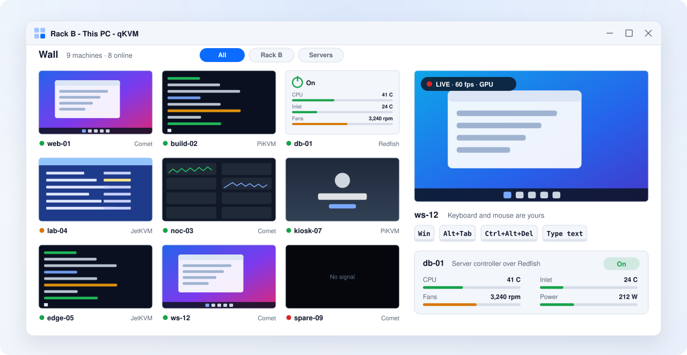
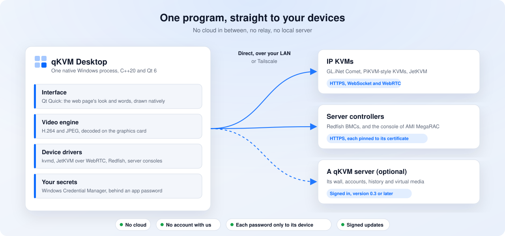

<a href="https://qkvm.com"><picture><source media="(prefers-color-scheme: dark)" srcset="https://raw.githubusercontent.com/qkvm/qkvm/main/.github/brand/qkvm-dark.svg"></picture></a>

# qKVM Desktop

**Every KVM and server screen you run, on one native Windows wall.** 
Open source. No server, no cloud, no account. Built in C++ and Qt 6 for video that feels like you are sitting at the machine.

[Website](https://qkvm.com) · [Download](https://github.com/qkvm/qkvm-desktop/releases/tag/v0.1.1) · [qKVM server](https://github.com/qkvm/qkvm) · [Live demo of the web app](https://demo.qkvm.com) · [Documentation](https://docs.qkvm.com) · [Security](SECURITY.md)

 

<a href="https://github.com/qkvm/qkvm-desktop/releases/tag/v0.1.1"><picture><source media="(prefers-color-scheme: dark)" srcset="https://raw.githubusercontent.com/qkvm/qkvm-desktop/main/docs/readme/hero-dark.svg"></picture></a>

An illustration of the wall. The machines are made up.

 

&nbsp;

Version 0.1.1, a beta. For Windows 10 (22H2) and Windows 11, x64. No administrator rights needed.

 

## What is this?

An **IP KVM** is a small box (or a server's own management controller) that lets you see a computer's screen and
use its keyboard and mouse over the network: from the moment it powers on, through the BIOS, even when its
operating system is down. Homelabs, offices and data centers use them to look after machines nobody sits in front of.

**qKVM** puts all of those screens on one wall. You see every machine live at a glance, and with one click you work on
one of them as if you were there. qKVM comes in two forms that share one look and one way of working:

- **qKVM Desktop** (this repository): a native Windows program for one PC. Nothing else to run.
- **[qKVM server](https://github.com/qkvm/qkvm)**: a self-hosted web app for a team, opened in any browser.

They work together: the desktop can sign in to a qKVM server and show that server's wall beside its own.

## Highlights

<table>
  <tr>
    <td width="33%" valign="top">
      <b>A live wall</b> 
      Every machine's screen, its name and its state, on one wall that you can sort into groups and spread
      over several windows and monitors.
    </td>
    <td width="33%" valign="top">
      <b>One machine, live and smooth</b> 
      H.264 decoded on your graphics card, every frame shown, about half a millisecond from arrival to screen.
    </td>
    <td width="33%" valign="top">
      <b>Your real keyboard</b> 
      The Windows key, Alt+Tab and the other keys a browser keeps go to the machine, not to your PC. Typed text,
      saved key combinations, keys on screen.
    </td>
  </tr>
  <tr>
    <td width="33%" valign="top">
      <b>Servers too</b> 
      Server boards through their management controller over Redfish: power, health, temperatures, fans, the
      locator light, and the server's own screen where its controller runs AMI MegaRAC.
    </td>
    <td width="33%" valign="top">
      <b>Safe with passwords</b> 
      Each device is known by the certificate it first showed. Its password goes to that device only, and is kept in
      Windows Credential Manager behind the program's own app password.
    </td>
    <td width="33%" valign="top">
      <b>Signed updates</b> 
      A daily check of a feed signed with the release key. An installed copy updates itself with Install and
      restart, and the setup it downloaded is checked against that feed before it runs.
    </td>
  </tr>
</table>

**Works with** GL.iNet Comet · PiKVM-style KVMs (kvmd) · JetKVM · servers with a Redfish management controller (BMC),
including the console of AMI MegaRAC · a [qKVM server](https://github.com/qkvm/qkvm) 0.3 or later.

qKVM is an independent project. It is not affiliated with GL.iNet, PiKVM, JetKVM or AMI.

## Desktop or web?

Both are free and open source under the same licence. Pick by where you work; many people run both.

| | **qKVM Desktop** | **qKVM server (web app)** |
|---|---|---|
| **Best for** | One person at a desk, a NOC screen, a laptop on the road | A team that shares one wall, from any browser |
| **What it is** | A native Windows program | A self-hosted server you open in a browser |
| **Install** | A setup or a ZIP, no administrator rights | pip or Docker, on Linux or Windows |
| **Needs a server** | No | It is the server |
| **People** | One per PC, with an app password and a lock | Accounts with three roles, two-factor sign-in and a recovery key |
| **GL.iNet Comet, PiKVM-style KVMs** | ✓ | ✓ |
| **JetKVM** | ✓ | ✓ |
| **Servers over Redfish:** power, health, sensors | ✓ | ✓ |
| **A server's own screen** (AMI MegaRAC) | ✓ | ✓ |
| **OpenBMC's console** | Planned | ✓ |
| **PCs with Intel AMT, VNC servers, Proxmox VE** | Planned | ✓ |
| **Virtual media** (mount an ISO) | Through a qKVM server | ✓ |
| **Keyboard** | Taken in its window, the Windows key and Alt+Tab included | The keys the browser lets through |
| **Video** | Decoded on your graphics card, in the program | Decoded in the browser |
| **Windows and monitors** | Several windows, across monitors | Browser tabs and windows |
| **Alerts** | On screen, when a machine goes away or comes back | On screen, by webhook and syslog |
| **Updates** | Signed feed; Install and restart | In place, or by pip or Docker |
| **Licence** | AGPL-3.0 | AGPL-3.0 |

As of qKVM Desktop 0.1.1 and qKVM server 0.3. "Planned" has no date yet.

## Why native C++, and not Electron?

qKVM Desktop could have been the web app in a window. We chose not to, because a console is only as good as the
moment the picture reaches your eyes and your keystroke reaches the machine. Electron is a fine choice for many
programs; a console you sit at all day is not one of them. So there is nothing between the network and the screen
but our own code and your graphics card.

- **Video is the product.** One machine at 60 frames a second, every frame shown, decoded on the graphics card in
  the same process that draws the window: 0.5 to 0.7 ms on average from a frame's arrival to the screen, at 1080p60
  and at 4K60 ([SPEC.md](SPEC.md), section 9). A bundled browser engine would add its own video pipeline and
  compositor in between.
- **Keys a browser never gets.** The Windows key, Alt+Tab and the like belong to your PC in a browser. A native
  program can take them for the machine you are working on, and hand them back with a leave key.
- **Small and quiet.** One process. No bundled browser engine, no Node.js, no local web server. About 19 MB to
  download. A wall of 64 previews at one picture a second took 0.33 % of a current desktop PC's processor.
- **Fewer things to trust.** A short list of dependencies, each pinned: Qt 6.12 and FFmpeg (both LGPL), and
  libdatachannel with Mbed TLS for WebRTC. Every download the build makes is checked by its SHA-256, and WebRTC is
  built from pinned sources. Every line of qKVM's own code is written for this project.
- **The same product, twice.** Not a wrapper: the desktop has the web page's look and words, drawn natively with Qt
  Quick, and speaks to every device itself.

 

<picture><source media="(prefers-color-scheme: dark)" srcset="https://raw.githubusercontent.com/qkvm/qkvm-desktop/main/docs/readme/how-it-connects-dark.svg"></picture>

## Get started in a minute

1. **Download** the [setup](https://github.com/qkvm/qkvm-desktop/releases/download/v0.1.1/qKVM-Desktop-0.1.1-windows-x64-setup.exe)
   (or the ZIP) and start it.
2. **Choose an app password.** It guards the passwords of your devices. Leave "Sign in automatically on this PC"
   ticked only if the PC is yours alone.
3. **Add your first KVM or server** by its address, or let qKVM find the devices on your network. Its screen
   appears on the wall; open it to work on that machine.

Already run a [qKVM server](https://github.com/qkvm/qkvm)? Sign the program in to it, and its wall appears beside
your own.

## Download

For Windows 10 (22H2) and Windows 11, x64, the same program in two forms:

- **The setup**,
  [qKVM-Desktop-0.1.1-windows-x64-setup.exe](https://github.com/qkvm/qkvm-desktop/releases/download/v0.1.1/qKVM-Desktop-0.1.1-windows-x64-setup.exe).
  It installs the program for you alone, without asking for an administrator, into
  `%LOCALAPPDATA%\Programs\qKVM Desktop`, and adds it to the Start menu (to the desktop only if
  you tick that) and to Settings, Apps.
- **The ZIP**,
  [qKVM-Desktop-0.1.1-windows-x64.zip](https://github.com/qkvm/qkvm-desktop/releases/download/v0.1.1/qKVM-Desktop-0.1.1-windows-x64.zip).
  Nothing is installed: unpack the whole ZIP into a folder of its own and start
  `qkvm-desktop.exe` in it.

The same files are also at
[download.qkvm.com](https://download.qkvm.com/desktop/0.1.1/qKVM-Desktop-0.1.1-windows-x64.zip), where
copies of 0.1.0 take their update from. Both files, their `SHA256SUMS` and the release notes are on the
[release page](https://github.com/qkvm/qkvm-desktop/releases/tag/v0.1.1). At the first start
the program asks for a password of its own.

**This is a beta.** Try it first where a mistake costs little.

Windows may say it protected your PC: neither file is signed with a certificate yet. Choose
More info, then Run anyway.

### Check the download

Before you run the setup or unpack the ZIP, compare its SHA-256 with the line for it in
`SHA256SUMS` on the release page. In PowerShell, in the folder you downloaded it to:

    Get-FileHash .\qKVM-Desktop-0.1.1-windows-x64-setup.exe -Algorithm SHA256
    Get-FileHash .\qKVM-Desktop-0.1.1-windows-x64.zip -Algorithm SHA256

If the two differ, do not run it. `SHA256SUMS` itself is signed with the release key the program pins
(`SHA256SUMS.sig`).

### Upgrade and uninstall

To upgrade an installed copy, run the setup of the newer version: it installs over the copy
you have, where it is. Close the program first: while it runs, the setup asks you to close
it, and so does the uninstall.

An installed copy can also do it itself: when Settings, Updates offers a newer release, choose
Install and restart. qKVM checks the setup it downloaded against its signed feed, closes, lets
that setup install it, and starts again.

To upgrade a copy from the ZIP, close it and unpack the newer ZIP into a folder of its own, or
run the setup instead. Either finds your wall as it was (see below).

If an update was cut off (the PC lost power or the setup was ended) and qKVM no longer
starts, run the setup again, the newer one or the one you have: it puts the program back
first.

To uninstall it: Settings, Apps, Installed apps, qKVM Desktop, Uninstall. A copy from the ZIP
is removed by closing the program and deleting its folder.

### Where your data stays

Uninstalling the program, or deleting the folder of the ZIP, removes the program and nothing
of what it keeps for you. That stays with your Windows account, for the next copy you install
or unpack:

- the settings (the devices and servers of your wall, its layouts): `%LOCALAPPDATA%\QKVM Desktop`;
- crash summaries, video diagnostics and update downloads: `%LOCALAPPDATA%\qKVM\Cache`;
- the passwords of your KVMs and servers, saved actions and server sessions: Windows
  Credential Manager, in the entries whose names begin with `QKVM Desktop:`.

To remove those too, delete the two folders and those entries.

## With a qKVM server

Works on its own, and with a qKVM server 0.3 or later; what a server does not have is not
shown.

## Building

Windows 10 or 11, x64, and PowerShell 7. Four things are needed, and none of them is in the
repository:

1. **Microsoft's compiler.** Build Tools for Visual Studio 2022, with its C++ tools and its
   "C++ Clang tools": CMake, Ninja, clang-format and clang-tidy come with them. Installing it
   asks for administrator rights once, and takes about 9 GB:

       winget install --id Microsoft.VisualStudio.2022.BuildTools -e --override "--passive --wait --norestart --add Microsoft.VisualStudio.Workload.VCTools --includeRecommended --add Microsoft.VisualStudio.Component.VC.Llvm.Clang"

   Qt 6.12 refuses a compiler older than Visual Studio 2022's, and a CMake before 3.25.
2. **Qt 6.12.0**, the open-source edition, kept outside the repository because of its size
   (2.3 GB). The script takes only the modules the program uses, and writes where it put them
   into `local.cmake`, which git does not keep:

       tools\fetch_qt.ps1 -Into D:\Qt

3. **FFmpeg**, an LGPL build, into `.deps` (180 MB):

       tools\fetch_ffmpeg.ps1

4. **Native WebRTC**, libdatachannel 0.24.6 with Mbed TLS 3.6.7, built here from pinned
   sources (`experiments/webrtc/dependencies.json`). It installs no runtime or toolchain
   for the whole PC:

       tools\fetch_webrtc.ps1

   CMake copies `datachannel.dll` beside each program. Its C interface is used across the
   DLL boundary, so the release library also serves the debug and sanitizer builds.

The Qt and FFmpeg scripts check each downloaded archive against its recorded size and SHA-256.
Then:

    tools\check.ps1            all of it: how the code is set, three kinds of build, every test, the linters
    tools\build.ps1            the debug build alone, while working
    tools\run.ps1              starts the program
    tools\package.ps1          the program folder and its ZIP, under build\packages
    tools\make_testdata.ps1    makes the pictures the engine is tested and measured with

`tools\check.ps1` keeps everything it printed in `build\check.txt`; it has passed when its
last line says so. A test that passes only when it is run a second time is named there.

How the program is meant to behave is in [SPEC.md](SPEC.md), and how it is built in
[DESIGN.md](DESIGN.md). What changed from one release to the next: [CHANGELOG.md](CHANGELOG.md).

## Security

What is kept where, what the program connects to, and how to report a problem:
[SECURITY.md](SECURITY.md).

**The app lock on a shared Windows account.** A passer-by has no control through qKVM's
interface alone; with the Windows account, a Credential Manager Restore can replace the app
password record and its retry count. Also, restoring an older backup resets the wrong-try
count. Windows Credential Manager's *Back up Credentials* can export qKVM's secrets without
the app password, and *Restore* may bring in a password record and secrets from another PC.
App lock alone cannot protect saved secrets from another person who uses that unlocked
Windows account.

## Licence

Copyright (c) 2026 qKVM, part of [PyPV Python Platform Ventures](https://pypv.com). Free
software under the [GNU Affero General Public License, version 3](LICENSE) only: you may use,
study, change and share it, and if you pass it on, or run a changed version for others, you
must offer them your source under the same licence. It comes with no warranty. The name qKVM
and its logo are not covered by that licence.

Every line here is written for this project: no code is copied from another project, whatever
its licence. The libraries the program ships with, and their licences:
[THIRD-PARTY.md](THIRD-PARTY.md) and [licenses/](licenses/). Reports are welcome; pull requests
are not taken.

 
<a href="https://qkvm.com"><b>qkvm.com</b></a> · <a href="https://github.com/qkvm/qkvm">qKVM server</a> · <a href="https://demo.qkvm.com">Live demo</a> · <a href="https://docs.qkvm.com">Documentation</a>

